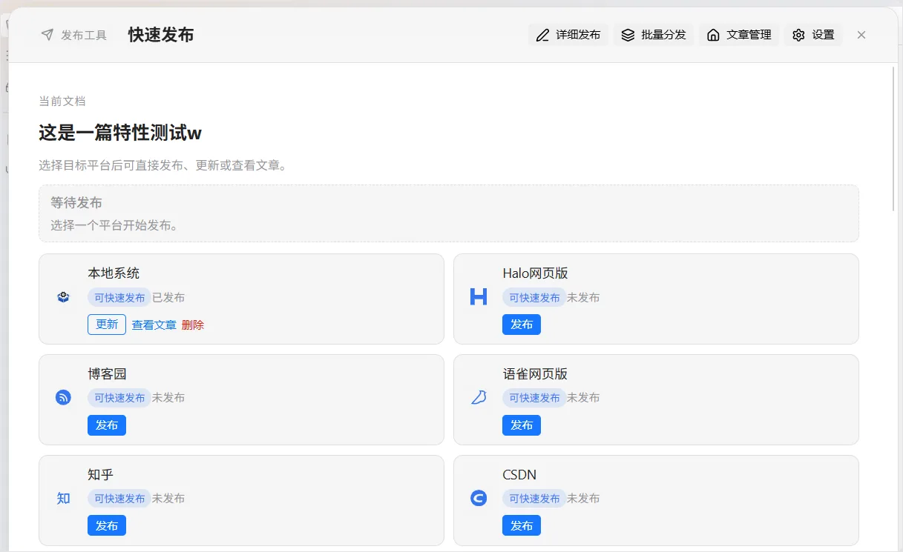
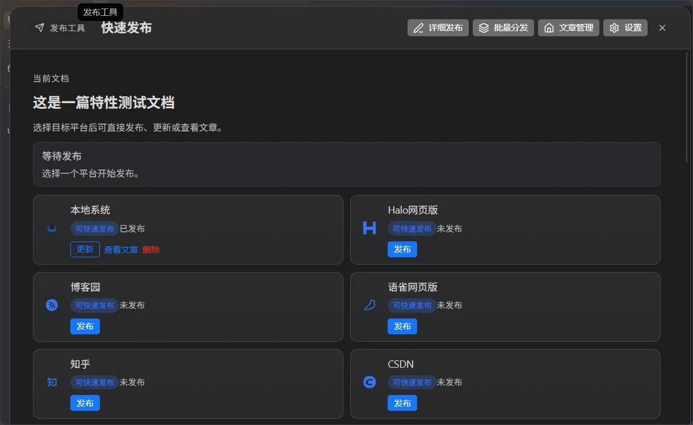

# 快速发布

快速发布是最常用的入口：选一个平台，一键把当前文档发出去。

## 入口

发布面板首页。打开面板即进入快速发布，顶部显示当前文档标题。

## 流程

1. 确认顶部「当前文档」是你要发布的那篇。
2. 在平台卡片里选一个目标平台。
3. 点「发布」。发布结果会直接显示在卡片上。

## 当前文档识别

**2.4.0 修复了多页签场景下「未检测到当前文档」、导致无法继续快速发布的问题。** 打开多个文档并切换到后面的页签时，快速发布现在能够正确识别活动文档，不再受前面已隐藏页签的富文本标题影响。

发布前仍请核对面板顶部的文档标题。若使用旧版本时遇到这一问题，请升级至 2.4.0。

## 卡片上的状态

| 状态 | 含义 | 可执行操作 |
|---|---|---|
| 未发布 | 这篇文档还没发到该平台 | 发布 |
| 已发布 | 已发过，卡片上会显示发布记录 | 更新、查看文章、删除 |
| 需授权 | 该平台账号还没完成授权 | 先去「发布设置」完成授权 |

## 与文章管理的联动

- 在**文章管理**里点某篇文档的「闪发」或「单发」，会带着该文档进入快速发布或详细发布。
- 发布前会执行**发布源笔记本**校验：不在授权范围内的文档会被拦下并给出明确提示。

## 下一步

- 需要调标题、摘要、标签、分类：[详细发布](./single-publish)
- 一次发到多个平台：[批量分发](./batch-publish)