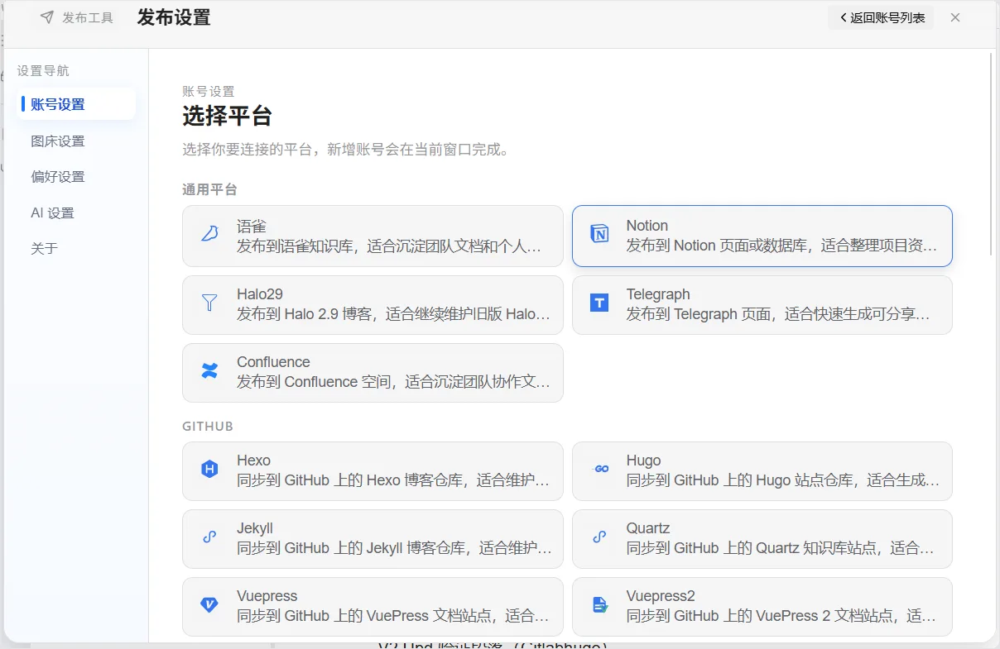
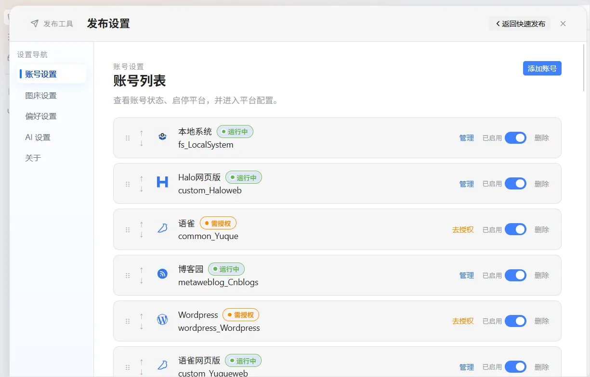
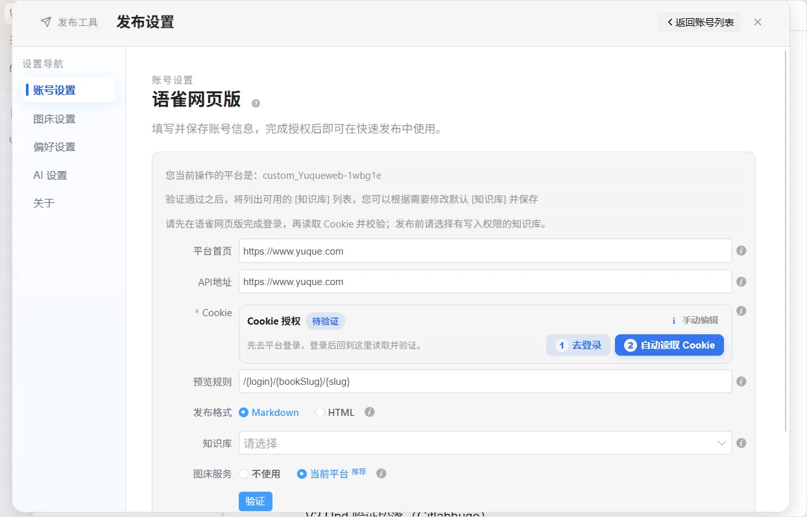

# 发布设置

设置左侧分五个入口：**账号设置**、**图床设置**、**偏好设置**、**发布记录**、**人工智能**，末尾还有**关于作者**。

## 账号设置

新增、编辑、启用或删除平台账号，并验证连通性。

每个账号一行，可以看到：

| 项 | 说明 |
|---|---|
| 状态 | 「运行中」表示验证通过；「需授权」表示还要完成一次授权 |
| 平台 key | 该账号的唯一标识，例如 `custom_Yuqueweb` |
| 管理 | 进入该平台的配置页 |
| 已启用 | 关掉后该平台不参与批量分发 |
| 删除 | 移除这个账号配置 |

账号行左侧的手柄可以**拖动排序**，顺序会持久化，并同步到快速发布的卡片顺序。

平台配置页里，每一行右侧的 ⓘ 可以查看该字段的说明与示例。

## 图床设置

配置图片上传方式。可选平台原生直传、内置的阿里云 OSS / 腾讯云 COS，或本机 PicGo。

从 2.4.0 起，还可在「按目录排除自动上传」中，为指定目录及其子文档或整个笔记本关闭图片自动上传。单篇文章可在发布页单独设置，并优先于目录规则生效。操作步骤与生效范围见[控制图片自动上传](./picbed#控制图片自动上传)。

## 偏好设置

一组影响发布行为的开关：

| 项 | 说明 |
|---|---|
| 去除标题编号 | 发布时去掉文章标题和正文各级标题开头的编号（含思源「标题块自动编号」） |
| 不更新原始标题 | 保持思源原文标题不被平台化处理覆盖 |
| 去除正文 H1 / 去除挂件 HTML | 去除正文 H1；开启挂件清理后，同时移除思源挂件与 HTML 块（含 oembed、书签等第三方插件卡片） |
| 菜单显示开关 | 控制文档快捷菜单、快速发布、详细发布、批量分发、AI、文章管理等入口是否显示 |
| 忽略块引用 | 发布时忽略文中的块引用 |
| 允许修改别名 | 允许改文章别名（slug）；开启后需自行保证唯一，否则可能发布失败 |
| 发布源笔记本 | 限定允许发布的笔记本；**留空 = 不限制** |

### 关于发布源笔记本

用来收敛「文章管理」的列表范围，并隔离公开与非公开内容。

- 选中后**只能发布**这些笔记本内的文档
- 文章管理的列表也会跟着过滤
- 发布不在范围内的文档会被拦下并给出提示
- 系统笔记本与用户指南笔记本会自动排除在可选范围外

## 发布记录

管理当前文档在各平台上的**发布记录**：哪篇文档发布到了哪个平台、平台上的文章 ID 是多少。
列表只显示真正发布过的平台，每行可以「编辑」文章 ID 或「解绑」。

### 什么时候需要它

- 更新或删除文章时提示失败：平台上那篇文章可能已经被删除，需要先解绑再重新发布；
- 发布记录和平台上实际的文章 ID 对不上：直接编辑该平台的记录；
- 文档 ID 变了（删除重建、拆分合并、从别的工作区导入）：用列表底部的「关联已有文章」把旧记录接回来。

### 编辑与解绑

1. 打开文档（面板会自动带上当前文档，不需要手填 ID）。
2. 进入**设置 → 发布记录**。
3. 在列表里找到对应平台：
   - 点「编辑」可以改记录里的文章 ID，确认后立即保存；
   - 点「解绑」并再次确认后，插件不再关联这篇文档与该平台的文章。

::: tip 解绑不会删除平台上的文章
解绑只清理插件里的本地记录（平台 YAML 属性也会一并清空），不会调用平台接口。
文章仍然留在平台上；之后再次发布会被当作一篇新文章。
:::

### 平台上有旧文章？关联已有文章

「发布修复」的场景收在列表底部的这个入口里：文档 ID 变化后，原发布记录找不到这篇文档，
文章管理里显示「未发布」，但平台上的文章其实还在。直接重新发布会造成重复文章。

1. 打开**文档 ID 已经变化**的新文档；
2. 进入**设置 → 发布记录**；
3. 展开「平台上有旧文章？关联已有文章」；
4. 选择平台，填入**平台上实际存在的文章 ID**，点「关联」。

记录重新对上之后，再次发布就是对平台上的旧文章做更新。

### 怎么拿到平台上的文章 ID

| 平台类型 | 从哪里拿 |
|---|---|
| 多数博客平台 | 打开文章，看地址栏里的数字或 slug |
| GitHub / GitLab 系 | 记录里的 `postid` 对应文章在仓库中的路径或 slug |
| 网页授权平台 | 打开文章编辑页，地址栏里通常带有文章 ID |

### 与「强制删除」的区别

| 操作 | 做什么 |
|---|---|
| **发布记录 → 编辑** | 改记录里的文章 ID（记录本来就在） |
| **发布记录 → 解绑** | 丢弃该文档在该平台的发布记录，之后重新发布 |
| **发布记录 → 关联已有文章** | 保留旧记录，把它接回新文档 |
| **强制删除**（发布页） | 与「解绑」效果相同，只是入口在发布页/快速发布卡片 |

需要重新发布时用解绑（或强制删除）；只是想恢复关联时用「关联已有文章」。

## 人工智能

配置 AI 服务，用于自动生成标题、摘要、标签与分类。详见 [AI 辅助](./ai)。

## 下一步

- 平台字段不清楚：看[平台支持](/platforms/)里对应平台的那一篇
- 遇到问题：[常见问题](./faq)