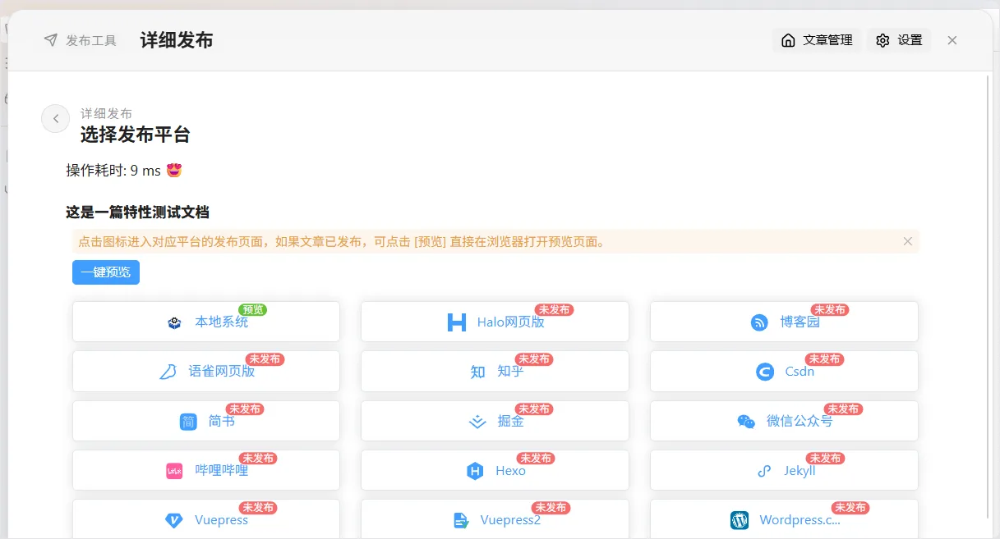

# 详细发布

详细发布把发布前的每一项参数都摊开：标题、摘要、标签、分类、别名、发布时间、状态等，适合需要精细控制的场景。



## 入口

- 快速发布的平台卡片上点「详细发布」
- 文章管理里某篇文档的「单发」

## 两步流程

### 第一步：选择平台

按平台图标选择目标平台。已发布过的平台会标出「预览」，未发布的标「未发布」。

### 第二步：编辑发布内容

| 项 | 说明 |
|---|---|
| 编辑模式 | 简洁 / 详细 / 源码三种，按需要切换 |
| 文章标题 | 默认取文档标题，可修改，也可点「自动提取标题」 |
| 摘要 | 平台未返回时回退到思源笔记的摘要 |
| 标签 / 分类 | 平台支持时生效；平台未返回时回退到思源笔记 |
| 知识空间 / 专栏 / 文集 | 取决于平台；配置存值，编辑时只读 |
| 别名（slug） | 影响文章链接；文档没生成过时按本次发布结果写回 |
| 图床服务 | 按平台分别指定 |
| 图片自动上传 | 跟随设置 / 自动上传 / 不自动上传；文章设置优先于目录规则，对所有平台生效，选择后自动保存 |
| 同步修改到思源笔记 | 按钮：把当前表单内容写回文档属性（详见下一节） |

### 「同步修改到思源笔记」会写什么

它**不发布文章**，只把当前编辑页的内容写回思源文档，让下次打开这个页面时可以直接沿用：

- **思源自带属性**：摘要（`memo`）、标签（`tags`）、分类（`custom-categories`）
- **当前平台的 YAML**：按表单里的标题、摘要、标签、分类、发布时间、更新时间、别名等重新生成，连同永久链接一起写入文档的自定义属性；已发布过的文章下次打开会读回这份 YAML
- **不写正文**：正文和图片始终以文档原文为准，图片仍在上传/发布时处理

几条规则：

- 直接点「发布 / 更新」时这些内容同样会写回，不必先点这个按钮
- **源码模式**下以编辑框里的 YAML 为准：先点「马上保存」把 YAML 解析进模型，再同步就写回你编辑的那份
- 只在表单里改了内容、既不同步也不发布：改动只存在于当前页面，换页后丢失

### 源码模式与图片

源码模式显示文档的**原始 Markdown**（图片为本地 `assets/` 路径），编辑期间不改动文档：

- 允许自动上传时，图片的**上传与链接替换统一在发布时执行**；关闭自动上传时保留原图片链接，远端可能无法显示本地图片
- 允许自动上传且正文包含图片时，编辑区顶部会给出提示，并可点「**上传并预览替换后的内容**」：立即上传图片并以替换后的结果预览，再点「恢复原文」切回；文章设置或目录规则禁止上传时，只显示「按设置不上传」，不提供上传预览入口
- 预览**仅用于查看**，不写入文档；保存与发布始终使用原始内容
- 预览适用于「PicGo」与平台自带图床（配置里的「当前平台」）两种方式；图床服务选「不使用」时不提示；批量分发没有单平台上下文，不提供预览

图片上传的配置步骤与优先级见[控制图片自动上传](./picbed#控制图片自动上传)。

## 详细模式的思源元数据

详细模式里的标题、摘要、标签、分类、发布时间和更新时间默认跟随当前思源文档：文档中修改后，重新打开发布页会看到最新值；文档没有填写的字段保留平台侧已有值。

如果某个字段在详细模式里手动改过并发布，插件会把该字段记为该平台的覆盖值；再次打开时优先显示覆盖值，不会被文档内容覆盖。把覆盖字段改回思源文档里的值并发布后，覆盖会自动移除，重新跟随文档。

源码模式直接编辑 YAML，以编辑器里的值为准。

## YAML 预设配置

静态站点平台的账号配置页提供「YAML 预设配置」，用于为文章的 Front Matter（Markdown 顶部的 YAML 元数据）添加或覆盖字段。填写的是 **JSON 对象**，不是 YAML 文本。

2.4.0 起，预设的取值支持按当前文章自动填入：

- `[title]`、`[slug]`：标题、文章别名。
- `[tags]`、`[categories]`：标签、分类；整个值仅包含该占位符时输出 YAML 数组，嵌在文本中时用逗号连接。
- `[createDate]`、`[updateDate]`：创建时间、更新时间，默认格式为 `YYYY-MM-DD`。
- `[createDate-YYYY-MM-DD HH:mm:ss]`、`[updateDate-YYYY-MM-DD]`：自定义日期格式；没有更新时间时使用创建时间。格式区分大小写。

2.5.0 起，预设还能读取思源文档属性（包括 `custom-*` 自定义属性，以及 `memo`、`alias` 等内置属性）：

- `[attr:属性名]`：按当前文档写入属性值，例如 `[attr:custom-cover]`。属性名按思源中保存的完整名称填写；精确匹配优先，兼容历史大写属性名。
- `[attr:属性名|int]`、`[attr:属性名|float]`、`[attr:属性名|bool]`：把属性值转换为数字/布尔。转换失败时保留原字符串，未知类型按字符串处理。
- 整个值只有该占位符时写入转换后的原生类型；嵌在文本中时按文本替换。属性不存在或为空时：整个取值就是该占位符则不写该字段，嵌在文本中则替换为空字符串；数组中的缺失项会被跳过。
- 采用显式映射：只有你列出的属性才会进入 Front Matter，不会自动带上全部文档属性。

2.5.0 起，支持封面图的静态站平台（当前为 Hexo、GitLab Hexo）还可以使用 `[cover]`：

- `[cover]`：详细发布模式里设置的封面图地址（发布时已上传到平台图片仓库的可用地址）。
- 整个值只有 `[cover]` 时输出字符串；封面为空时不写该字段，嵌在文本中时替换为空字符串。
- 默认封面字段是 `cover`；主题使用其它字段时用 `[cover]` 映射，例如 `{"index_img":"[cover]"}`、`{"banner_img":"[cover]"}`。使用 `[cover]` 映射后，插件不再额外写默认 `cover`。

例如，为站点自动填写创建时间、封面与权重：

```json
{
  "updatedDate": "[updateDate-YYYY-MM-DD]",
  "tags": "[tags]",
  "categories": "[categories]",
  "cover": "[attr:custom-cover]",
  "weight": "[attr:custom-weight|int]",
  "draft": "[attr:custom-draft|bool]"
}
```

字段名需符合你的站点要求；同名字段会覆盖插件自动生成的值。占位符也可用于嵌套对象、数组中的字符串值；未知占位符保留原样。保存时会校验 JSON 格式，格式不合法时会提示修改。

这一能力适用于 Astro、Hexo、Hugo、Jekyll、VuePress、VuePress 2、VitePress、Quartz、Docsify 的 YAML 转换，以及相应的 GitLab 平台；预设留空时仍沿用各平台原有默认值。文档属性占位符同样适用于这些平台。

::: tip 修改预设会同步到已有文章
预设会在每次生成 Front Matter 时逐键合并：首次发布、更新以及打开详细发布的源码模式都会应用；同名键以预设为准，会覆盖自动生成或已保存的同名值。源码模式展示的就是合并后的 YAML，某篇文章需要临时覆盖预设字段时，在源码模式改好后点「马上保存」再发布即可。
:::

## 可以做的操作

- **发布 / 更新**：首次发布用「发布」，之后用「更新」
- **强制删除**：清理该平台的发布记录
- **查看文章**：按「预览地址」模板打开仓库里的 Markdown 源文件；站点上的文章地址由「文章预览规则」写进 Front Matter 的 `permalink`（Hexo / Quartz 生效），两者不是同一个链接

::: tip 合并模式的例外
批量分发使用「合并」模式时，标题与摘要的改动不生效（标签与分类会合并）。需要改标题请回到单平台发布操作。
:::

## 下一步

- 一次发到多个平台：[批量分发](./batch-publish)
- 回看发布记录：[文章管理](./article-manage)