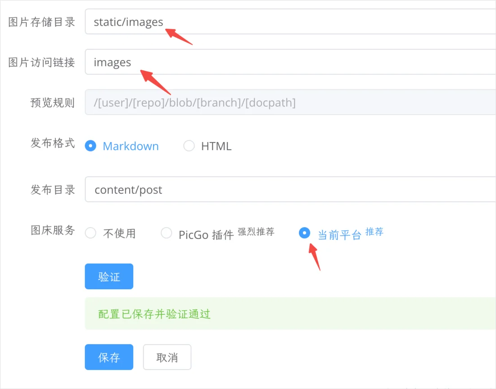

# Hexo 配置指南

通过 **GitHub API** 将文章发布到 **Hexo** 静态博客仓库。

## 一、准备

1. 一个可作为 Hexo 博客仓库的 **GitHub 仓库**（如 `hexo-blog`）。
2. 一个对该仓库有 **push 权限** 的 **GitHub Token（PAT）**（GitHub Settings → Developer settings → Personal access tokens，勾选 `repo` 权限）。

## 二、配置

| 字段 | 填什么 |
|------|--------|
| 首页地址 | GitHub 首页地址，默认 `https://github.com` |
| API 地址 | GitHub API 地址，默认 `https://api.github.com`，通常无需修改 |
| 用户名 | GitHub 用户名（owner），用于拼出仓库地址 |
| 鉴权 Token | GitHub 个人访问令牌（PAT），需对目标仓库有 push 权限 |
| git 仓库名 | Hexo 博客仓库名，与用户名组成 `<user>/<repo>`，如 `hexo-blog` |
| 默认分支 | 发布到的分支，默认 `main`，需与仓库实际分支一致 |
| 存储目录 | Hexo 文章存储目录，默认 `source/_posts` |
| 文件规则 | 文章文件名规则，默认 `[filename].md` |
| 文章预览规则 | 站点文章预览规则，默认 `/post/[postid].html` |
| 预览规则 | GitHub blob 预览规则，默认 `/[user]/[repo]/blob/[branch]/[docpath]` |
| 图床 | Hexo 支持内置图床，选「当前平台」：图片上传到仓库 `source/images`（默认），文章引用为相对路径 `../images/<图片名>`，保证源码与构建产物都能显示 |

## 三、验证与发布

1. 点「验证」→ Token、仓库、分支校验通过（会向仓库发布并清理测试文件）→ 保持「配置已保存并验证通过」。
2. 快速发布 → 选 Hexo → 发布。文章 `.md` 会提交到 `存储目录/文件名.md`。
3. 点「查看文章」能看到该 `.md` 的 GitHub blob 地址；带图发布时图片会一并上传到仓库图床目录。

## 四、文件规则

「文件规则」决定文章在仓库里的**相对路径与文件名**，默认 `[filename].md`。

可用占位符会动态替换：

| 占位符 | 含义 | 示例 |
|---|---|---|
| `[yyyy]` | 年 | `2025` |
| `[MM]` | 月 | `02` |
| `[mm]` | 月（不补零） | `2` |
| `[dd]` | 日 | `26` |
| `[slug]` | 别名 | `test-document-xdfr45f` |
| `[filename]` | 文档真实标题 | `测试文档` |
| `[category]` | 第一个分类（没有则忽略） | `技术` |
| `[cats]` | 全部分类组合 | `技术-笔记` |
| `[tag]` | 第一个标签（没有则忽略） | `思源` |
| `[tags]` | 全部标签组合 | `思源-发布` |

例如 `[yyyy]/[MM]/[filename].md`、`[slug].md`、`[yyyy]-[mm]-[dd]-[slug].md`。

::: tip 链接字符限制
路径中只允许 `/ - _ . ~`，其他字符会被移除。
:::

## 五、图片存储路径

图床选「当前平台」时，可以指定图片存到仓库哪里：



| 字段 | Hexo 的默认值 |
|---|---|
| 图片存储目录 | `source/images` |
| 图片访问链接 | `../images` |

图片提交到仓库 `source/images`，正文引用相对文章目录的 `../images/<文件名>`；Hexo 构建后该目录复制到站点根，构建产物同样能显示。

2.4.0 起，「YAML 预设配置」支持日期、标题、别名、标签与分类占位符；2.5.0 起支持 `[attr:属性名]` 文档属性占位符与 `[cover]` 封面占位符。预设会在每次生成平台 YAML 时逐键合并，已发布文章的更新也会应用；源码模式展示的就是合并后的 YAML。完整语法与覆盖规则见 [YAML 预设配置](/guide/single-publish#yaml-预设配置)。

## 六、封面图

详细发布模式提供可选的「封面图」，三种填写方式任选：

- **上传图片**：从本机选图，先存进思源资源库（`assets/`），发布时随文章提交到仓库图片目录；
- **填写图片地址**：支持完整图片链接，或已经存在的站内路径（如 `/images/cover.png`）；
- **取正文首图**：直接引用正文第一张图片。

发布时，思源资源图片会提交到「图片存储目录」（默认 `source/images`），并把平台可用地址写入文章 Front Matter 的 `cover` 字段；留空则不设置封面。更新时会回填上次选择；清空后更新会移除该字段。封面处理失败只提示，不影响正文发布。

Hexo 本身不定义封面字段，由主题读取。插件默认写 `cover`（Butterfly 等主题直接使用）；主题使用其它字段（如 Fluid 的 `index_img`、`banner_img`）时，在「YAML 预设配置」里用 `[cover]` 映射：

```json
{ "index_img": "[cover]", "banner_img": "[cover]" }
```

使用 `[cover]` 映射后，插件不再额外写默认 `cover`；没有设置封面时，对应字段会被省略。

## 七、详细模式的元数据

详细模式里的标题、摘要、标签、分类、发布时间和更新时间默认跟随当前思源文档；文档没有填写的字段保留平台侧已有值。如果某个字段在详细模式里手动改过并更新，插件会把它记为该平台的覆盖值，再次打开时优先显示覆盖值，不会被文档内容覆盖。把覆盖字段改回思源文档里的值并发布后，覆盖会自动移除。

源码模式直接编辑 YAML，以编辑器里的值为准。

## 常见问题

- **验证通过但发布失败**：确认 Token 对目标仓库有 push 权限，仓库名与分支正确，存储目录已存在。权限不足会收到 401/403。
- **图片要怎么发布**：选「当前平台」图床，图片上传到仓库 `source/images`，文章中引用相对路径（源码编辑器与构建产物均可正常显示）。
- **封面图怎么设置**：详细发布模式填写「封面图」后发布即可，图片与正文图片走同一套上传通道；主题封面字段不是 `cover` 时，用「YAML 预设配置」的 `[cover]` 映射到主题字段。
- **封面图不显示**：先确认主题使用的 Front Matter 字段名；默认写 `cover`，若主题使用 `index_img`、`banner_img` 等字段，需要加 `[cover]` 映射后重新发布。已有文章更新时沿用已保存的 YAML。
- **详细模式里改了标题/标签/更新时间，重新打开又变回文档内容？** 详细模式默认跟随思源文档；手动改过并更新后，插件会把这几个字段记为该平台的覆盖值，之后打开优先显示覆盖值。把字段改回文档值并发布后，覆盖会自动移除；源码模式直接编辑 YAML，以编辑器为准。
- **查看链接打不开**：确认预览规则（默认 `/[user]/[repo]/blob/[branch]/[docpath]`）与文件路径、分支对应。
- **「删除」和「解除关联」有什么区别**：删除会**先从平台移除文章**，再解除本地记录；解除关联（界面上是「强制删除」）**只解除关联**，不动平台上的文章。文章在平台上被手动删掉后，用解除关联可以修复记录，便于重新发布。
- **更新与删除**：点「更新」会重新提交并产生一次新提交；「删除」会从仓库移除对应 `.md`，需重新发布才能再次出现在站点。
